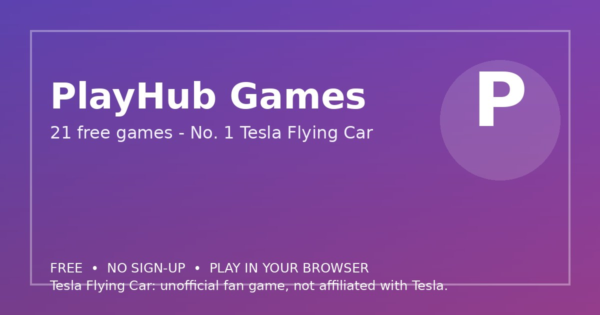

# PlayHub Games

Play 21 free games online - No. 1 Tesla Flying Car with DRIVE/FLY/LAND, plus Quiz, Snake, 2048, racing and action games. No download, no sign-up.

**Live site:** https://playhub-games-seven.vercel.app/
**GitHub repo:** https://github.com/flutterlive/playhub-games
**Language:** English only
**Cost:** Free, no sign-up, no payment

## What this site does

21 in-page games: 1. Tesla Flying Car (DRIVE/FLY/LAND, Stunt, Free Drive/Fly, Racing, 4 cities), 2. Brain Quiz Challenge, 3. Neon Snake, 4. 2048 Puzzle, 5. Flappy Wings, 6. Memory Match, 7. Tic Tac Toe vs AI, 8. Breakout, 9. Fruit Catcher, 10. Turbo Street Racer, 11. Bubble Pop Shooter, 12. Dino Dash Runner, 13. City Crime Driver, 14. Street Drift King, 15. Police Chase, 16. Gangster City Runner, 17. Sniper Shooter, 18. Zombie Survival, 19. Tank Battle, 20. Helicopter Strike, 21. Bike Stunt Rider. Full-page game view with Full Screen button. Note: Tesla Flying Car is an unofficial fan game, not affiliated with Tesla.

## How to run this project

This is a complete, static web project - no build step, no server, no Python and nothing to install.

1. Download or clone this repository.
2. Open `index.html` directly in any modern browser (Chrome, Edge, Firefox or Safari), or serve the folder with any static host.
3. That is all - the tool/game runs entirely in your browser.

### Serve it on a static host (optional)

- **GitHub Pages:** Settings > Pages > Deploy from a branch > main > root, then open the Pages URL.
- **Vercel:** Import https://github.com/flutterlive/playhub-games in Vercel, keep the defaults (no build command, output is the repository root), Deploy. Every push to `main` redeploys automatically.
- **Netlify:** Drag and drop this folder, or connect the repository and deploy with no build command.

### Files in this project

- `index.html` - the complete site (HTML, CSS and JavaScript in one file)
- `assets/og-image.jpg` - the 1200x630 link preview image used by Open Graph / Twitter cards
- `README.md` - this file

Best scores and tool state (where applicable) are saved in the browser's localStorage on the visitor's own device. No data is sent to a server by this page.

> Tesla Flying Car: unofficial fan game, not affiliated with Tesla.
